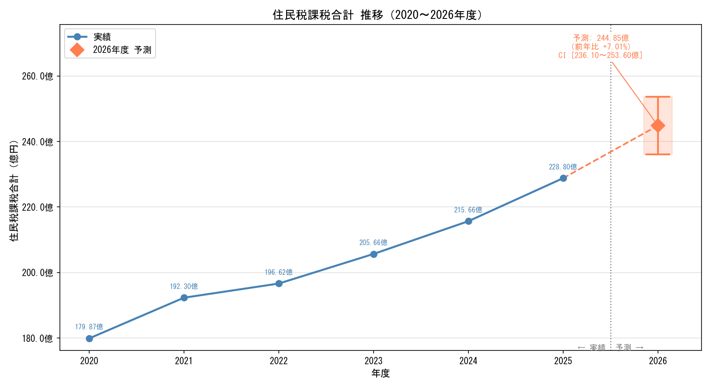
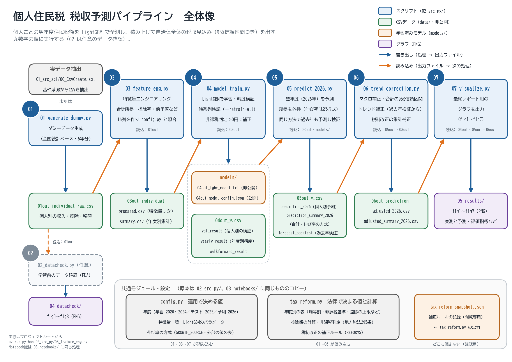

# 個人住民税の税収予測モデル（LightGBM）

個人ごとの収入・控除データから翌年度の住民税額を LightGBM で予測し、積み上げて**自治体全体の税収見込み（95%信頼区間つき）**を算出するパイプライン。
実務では実データで運用しており、このリポジトリでは全国統計をもとに生成したダミーデータで同じ処理を再現している。

**使用技術**: Python / LightGBM / pandas / scikit-learn / scipy / matplotlib / Jupyter / uv

---

## 背景と課題

- 住民税は自治体の主要財源で、翌年度の税収見込みの精度が予算編成の精度に直結する。
- 集計値にトレンドを掛ける従来の方法では、予測の精度・不確かさの幅（区間推定）・税制改正への対応に限界があった。
- そこで、個人単位で翌年度の税額を予測して合算し、税法のルールはモデルの外で確実に処理する仕組みを作った。

**役割・期間**：2026年7〜10月。企画は所属部署の職員と2人で行い、開発は1人で担当。

---

## モデルの実行結果



| | 集計誤差率（テスト年2025） | WMAPE | 2026年度の予測 | 
|---|---:|---:|---|
| ダミーデータ（597,000件・6年分） | +0.01% | 0.53% | 244.85億円（前年比 +7.01%、95%信頼区間 236.10〜253.60億円） |
| 実データ（6年分） | +0.61% | 6.25% | 税額非公開 |

- **主指標は集計誤差率**（予測合計と実績合計の差）。実データでは、従来のツールより税収合計と予測の誤差が約1/3に減少し、精度が向上した。
- 実データは個人単位の誤差がダミーより大きいが、個人ごとの誤差の多くは相殺されるため、税収合計の精度は保たれている。
- ダミーの精度が非常に高いのは、税額を特徴量と同じ計算式から作っているため。実データの金額・件数は非公開とし、精度の比率だけを載せている。
- 2026年度の予測と同じ手順で過去4年を予測し直した検証（過去年の検証）では、**ダミーデータ**の集計誤差率は平均 -0.41%（年ごとのぶれは標準偏差 1.00%）。この平均を補正に、ぶれを95%信頼区間に使っている。

**【ダミーデータ】過去年の検証**

| 予測した年度 | 学習に使った年度 | 予測に使った所得 | 実績との誤差 |
|---|---|---|---:|
| 2022 | 2020〜2021 | 2021年度の所得から推計 | +0.89% |
| 2023 | 2020〜2022 | 2022年度の所得から推計 | -1.49% |
| 2024 | 2020〜2023 | 2023年度の所得から推計 | -0.79% |
| 2025 | 2020〜2024 | 2024年度の所得から推計 | -0.25% |
| **予測対象** 2026 | 2020〜2025 | 2025年度の所得から推計 | （ダミーの作成は2025年までのため予測のみ） |

**【実データ】実運用の結果**

| | 予測の条件 | 集計誤差率 |
|---|---|---:|
| テスト（実データ・2025年度） | 2025の本当の所得・控除で予測（walk-forward） | +0.61% |
| 実運用（実データ・2026年度） | 2025の所得・控除から推計して予測し、2026年6月30日時点の実績と比較（年度途中の暫定値） | +0.41% |

実運用は、所得・控除を推計する誤差も含む条件である。それでもテスト年と同程度の誤差に収まり、検証で見積もった精度が実運用でも再現された。ただし1年分の結果のため、今後も年ごとに確認する。

全指標・検証条件は、末尾の「詳細」を参照。

---

## 処理の流れ



01→07 の順に処理し、各ステップのノートブックに処理内容と実行結果（表・グラフ）を保存している。

| # | ステップ | 概要 | ノートブックで見る場所 |
|---|---|---|---|
| 01 | ダミーデータ生成 | 全国統計（国税庁・厚労省・総務省）から6年分の個人データを生成。税額は実際の計算式で作る。実データは [抽出SQL](01_src_sql/00_CsvCreate.sql) で同じ列を出す | [01_generate_dummy](03_notebooks/01_generate_dummy.ipynb)：「年度別サマリーの表示」 |
| 02 | データ確認（EDA） | 課税・非課税の人数、所得と税額の分布・相関、定額減税の影響を確認 | [02_datacheck](03_notebooks/02_datacheck.ipynb)：各図の「考察」（特に fig2 相関・fig4 税制改正の前後・fig8 定額減税） |
| 03 | 特徴量エンジニアリング | 合計所得・控除合計・控除率などを作り、グループごとに外して効果を確認（アブレーション）。税額の内訳列はリークになるため除外 | [03_feature_eng](03_notebooks/03_feature_eng.ipynb)：冒頭の「生成特徴量の設計意図と検証結果」 |
| 04 | 学習・検証 | walk-forward で時系列に検証したあと、全年で再学習。予測後に非課税判定で0円に上書き | [04_model_train](03_notebooks/04_model_train.ipynb)：「ウォークフォワード検証の実行」「テストデータ精度の評価と過学習判定」「特徴量重要度の可視化」 |
| 05 | 翌年度予測 | 直近年の所得を伸び率で外挿して予測。同じ手順で過去4年も予測し、誤差を検証（過去年検証） | [05_predict_2026](03_notebooks/05_predict_2026.ipynb)：「伸び率の決め方」「結果サマリーの表示」「過去年検証（06 のトレンド補正の根拠）」 |
| 06 | 集計補正 | 過去年検証の平均の誤差で補正し、年ごとのぶれから95%信頼区間を算出 | [06_trend_correction](03_notebooks/06_trend_correction.ipynb)：「結果サマリーの表示」 |
| 07 | 可視化 | 予測結果・評価指標のグラフ7枚（[05_results/](05_results/)） | [07_visualize](03_notebooks/07_visualize.ipynb)：Fig4 最終予測サマリー・Fig6 税収時系列グラフ・Fig7 ウォークフォワード検証レポート |
| 共通 | 税法のルール | 法律で決まる値は年度別の表に、期間限定の補正はルールの一覧に分ける | [tax_reform.py](02_src_py/tax_reform.py)：冒頭の年度別の表と、末尾の `REFORMS` |

実行に使うスクリプトの本体は [02_src_py/](02_src_py/)（ノートブックと同じ処理）。設定は [config.py](02_src_py/config.py) に集約している。

---

## 設計の判断

| 観点 | 判断 | 業務の知識による理由 |
|---|---|---|
| モデルの選定 | LightGBM（勾配ブースティング木） | 住民税は、所得控除や非課税基準によって「ある金額を境に切り替わる」階段状の計算になる。決定木はこれをそのまま表現でき、データの前処理も少ない。異動のある職場で引き継げるよう、シンプルに保った。 |
| 所得の特徴量 | 合計所得は重なりのない所得区分だけを足して作る。控除合計と、控除率・課税標準率も加える | 同じ所得でも控除の特性によって税額が大きく変化するため、フラグの追加や所得と控除の比率を追加した。 |
| 翌年の所得控除 | 「前年の実績＋制度改正による差」で更新する。コード値で持っている控除は、住民税の控除額表で金額に換算する（実データ版） | 扶養・配偶者などの控除は人ごとに続くものなので、前年の値を引き継ぐ形を保った。 |
| 評価指標 | 主指標は集計誤差率（税収合計の誤差）。個人単位の誤差は補助に使う。 | 自治体の予算に必要なのは、個人の税額ではなく税収の合計のため、合計の精度を優先した。 |
| 税法のルール | 非課税判定（地方税法295条）は予測のあとにルールで0円に上書きする。法律で決まる値は年度別の表に、期間限定の補正はルールの一覧に分ける | 法律で決まることはモデルに推測させない。恒久的な改正と、定額減税のような期間限定の補正とは、性質が異なるため外部で管理。 |

---
## 限界と今後の課題

- 過去6年はいずれも上昇トレンドのため、トレンドが崩れた年や大きな税制改正の年に同じ精度が出るかは未検証。
- 予測では対象者を前年と同じとしており、転入・転出・死亡は反映していない（ダミーで試算したが改善せず、実データは検証中）。
- 高額所得者の細分化（所得の種類ごとの翌年の継続率など）による精度の向上。
- 精度を上げる一方で、職員間の引き継ぎを考え、データの加工は必要最小限にとどめる。

---
## 実行方法

```bash
uv sync                                                    # 依存パッケージのインストール（Python 3.14以上）
uv run python 02_src_py/01_generate_dummy.py               # ダミーデータ生成（実データの場合はCSVを置いて03から）
uv run python 02_src_py/02_datacheck.py                    # データ確認（任意。モデルとは独立）
uv run python 02_src_py/03_feature_eng.py
uv run python 02_src_py/04_model_train.py --retrain-all    # walk-forward検証 + 全年再学習
uv run python 02_src_py/05_predict_2026.py
uv run python 02_src_py/06_trend_correction.py
uv run python 02_src_py/07_visualize.py
```

ノートブック版（[03_notebooks/](03_notebooks/)）は上から順に実行すれば同じ結果になる。CLI 引数に当たる設定は各ノートブックの `NOTEBOOK_ARGS` セルで指定する。

---

## 詳細

<details>
<summary><b>評価指標・検証結果の全体</b></summary>

### 検証条件

| 項目 | ダミーデータ | 実データ |
|---|---|---|
| データ | `01_generate_dummy.py` で生成（全国統計ベース） | `01_src_sql/00_CsvCreate.sql` で抽出 |
| レコード数 | 597,000件（6年分、1年あたり98,800〜100,000件） | 非公開（6年分） |
| 使用スクリプト | `02_src_py/01〜07_*.py` | 実データ版（03〜07。非公開） |
| 実行オプション | `04_model_train.py --retrain-all`（walk-forward検証＋全年再学習） | 同左 |
| 学習年度（`TRAIN_YEARS`） | 2020〜2024年（最終モデルは`TEST_YEAR`を含む2020〜2025年で再学習） | 同左 |
| テスト年度／予測年度 | 2025年／2026年 | 同左 |

### 評価指標

TRAIN は2020〜2025年の in-sample（最終モデル）、TEST はウォークフォワードの最終フォールド（train=2020〜2024→test=2025）。実データの金額の指標は非公開。

| 指標 | 意味・式 | ダミー TRAIN | ダミー TEST | 実データ TRAIN | 実データ TEST | 位置づけ |
|---|---|---:|---:|---:|---:|---|
| 集計誤差率 | 合計のズレの割合<br>（予測合計−実績合計）÷実績合計 | -0.00% | +0.01% | +0.25% | +0.61% | （**主指標**）税収見込みの精度そのもの。符号付きのため、個人ごとの誤差のプラス・マイナスが打ち消し合う |
| WMAPE | 円で重み付けした誤差率<br>Σ\|誤差\|÷Σ実績 | 0.48% | 0.53% | 4.38% | 6.25% | （第2指標）円ベース。非課税者含む。集計誤差率の上限（全員が同じ向きに外れた場合に一致） |
| MAPE | 1人ずつの誤差率の平均<br>平均(\|誤差\|÷実績) | 1.59% | 1.38% | 8.46% | 11.52% | （参考）人数ベース。課税者のみ（実績0円は分母にできないため除外）。少額納税者の外れで大きくなる |
| MAE | 1人あたりの平均誤差額<br>平均(\|誤差\|) | 971円 | 1,227円 | 非公開 | 非公開 | （参考）1人あたり平均何円外れるか |
| RMSE | 二乗平均の平方根<br>√平均(誤差²) | 2,348円 | 4,560円 | 非公開 | 非公開 | （参考）大きな外れの荒れ具合。外れ値に引っ張られる |
| R² | 税額のばらつきの説明割合<br>1−Σ誤差²÷Σ(実績−平均)² | 1.000 | 1.000 | 0.818 | 0.712 | （参考）個人単位の当てはまりを、ダミーと実データ・年度間で見比べるため |

### 過去年の検証（ダミーデータ版。`05out_forecast_backtest.csv`、`06`のトレンド補正の根拠）

精度の測り方は3段階ある。2025年度を予測する場合で比べると、次のとおり。

| | 年度の関係 | 測れる誤差 |
|---|---|---|
| ① TRAIN（評価指標の表） | 2020〜2025で学習 → **2025の本当の所得・控除**で2025を予測 | ほぼなし（答えを見て学習している） |
| ② TEST（walk-forward。評価指標の表） | 2020〜2024で学習 → **2025の本当の所得・控除**で2025を予測 | モデル自体の誤差 |
| ③ 過去年の検証 | 2020〜2024で学習 → **2024の所得・控除から推計**して2025を予測 | モデル＋所得・控除を推計する誤差 |
| 2026年度の予測（`05`） | 2020〜2025で学習 → **2025の所得・控除から推計**して2026を予測 | ―（③と同じ条件） |

年度ごとの③の誤差は「[モデルの実行結果](#モデルの実行結果)」の表を参照。

### 2026年度の予測（`05`→`06`）

| 項目 | ダミーデータ | 実データ |
|---|---|---|
| 前年実績（2025年） | 228.80億円 | 非公開 |
| 2026年度 税収合計（`06`の補正後） | 244.85億円（前年比 +7.01%）※`05`の予測は243.85億円 | 非公開（税制改正による減税以上に、所得の上昇による増収が続く） |
| 予測人数（うち課税者数） | 98,800人（78,710人） | 非公開 |
| 95%信頼区間（`06`の補正後） | [236.10 〜 253.60] 億円（過去年の検証の年ごとのぶれ・t分布・4年。参考: 個人別の区間の合計は [240.85 〜 249.04]） | 非公開 |
| 所得の外挿率（実績トレンド直近2年平均） | 給与収入 +6.78%／事業所得 +0.73%／年金収入 +2.26% | 非公開 |
| `06`のトレンド補正 | 乗率 1.0041（過去年の検証の平均誤差率 -0.41% を打ち消す） | ― |
| `06`の税制改正の集計補正 | 適用する補正なし | ― |
| 予測と実績の集計誤差率（2026年6月30日時点） | ― | +0.41%（テスト年2025の +0.61% とは別の数値） |

### 所見

- ダミーのウォークフォワード検証（fold1〜4）は、すべて誤差率±0.1%以内・個人MAPE 1.4〜1.7%に収まり、安定している。
- ダミーの精度（R² 1.000）が高いのは、ダミーの税額を、特徴量に含まれる課税標準額などから同じ計算式で作っているため。実データは控除の持ち方や特定区間の偏り・外れ値があり、同じ精度にはならない。データ加工の流れは自治体ごとに検証する必要がある。
- 実データは個人単位の誤差が大きいが、本プロジェクトの目的である税収合計の精度（集計誤差率）は、ダミーと同等に保てている。
- 実データでは高額納税者を学習時に上限でクリップしたため、`05`の予測合計がやや小さめに出る。ただし、高額所得が単年で終わる可能性や、転出・死亡で翌年の税額が0円になる可能性を考えると、前年の値をそのまま使うよりリスクを抑えられる。

</details>

<details>
<summary><b>CLI版とノートブック版の関係</b></summary>

| | `02_src_py/`（CLI版） | `03_notebooks/`（Notebook版） |
|---|---|---|
| 役割 | モデル実行の本体（**原本**） | GitHub公開用。処理内容と実行結果（表・グラフ）を閲覧するために配置 |
| `config.py`・`tax_reform.py` | 原本 | 原本のコピー。ノートブックだけを取り出しても動くよう同じフォルダに置き、各ノートブックの先頭のセルで読み込み先に追加している |
| 変更するとき | このフォルダ内の`.py`を編集する | 原本を変えたあと、`config.py`・`tax_reform.py`をコピーし、ノートブックの該当セルにも同じ変更を入れ、上から実行し直して出力を更新する |

- 設定値やコードは必ず`02_src_py/`の原本を編集する。`03_notebooks/`だけを直すと、実行に使うCLI版に反映されないため注意。

- `main()`に集約せず、関数定義・実行・結果表示・保存をセル単位に分割しており、上から順に実行すると各ステップの出力（表・グラフ）がコード直下に表示される。
- CLI引数（`--walkforward`, `--year`等）に相当する設定は、各ノートブック内の`NOTEBOOK_ARGS`セルで指定する（`NOTEBOOK_ARGS = ["--retrain-all"]`のようにCLIと同じ文字列を並べる）。
- `04_model_train.ipynb`は、このREADMEに載せている結果と同じになるよう`NOTEBOOK_ARGS = ["--retrain-all"]`を設定済み。
- `03_notebooks/`から開いてそのまま実行してもプロジェクトルート基準の相対パスが解決できるよう、各ノートブックの先頭で自動的にカレントディレクトリをルートへ戻す処理が入っている。VS Code等で開く場合は`.venv`（`2026-chotei-01`）をカーネルに選択すること。

- `02_src_py/`の中から実行する場合は、フォルダ名を除いて`uv run python 06_trend_correction.py`のように指定する。

</details>

<details>
<summary><b>ファイル構成（入出力ファイルの一覧）</b></summary>

### ファイル構成

```
.
├── 01_src_sql/
│   └── 00_CsvCreate.sql          # 基幹系DBからの実データ抽出SQL
│
├── 02_src_py/                    # 実行スクリプト本体（CLI版。ルート／02_src_py どちらからでも実行可）
│   ├── config.py                 # 【原本】全設定値の一元管理（ここだけ触ればパラメータ調整可能）
│   ├── tax_reform.py             # 【原本】税制改正モジュール（計算式と補正ルール REFORMS）
│   │     out : models/tax_reform_snapshot.json（単独で実行したとき。補正ルールの記録）
│   │
│   ├── 01_generate_dummy.py      # ダミーデータ生成
│   │     in  : config.pyの設定値
│   │     out : data/01out_individual_raw.csv
│   │
│   ├── 02_datacheck.py           # データチェック（EDA・任意ステップ）
│   │     in  : data/01out_individual_raw.csv
│   │     out : 04_datacheck/*.png
│   │
│   ├── 03_feature_eng.py         # 特徴量エンジニアリング
│   │     in  : data/01out_individual_raw.csv
│   │     out : data/03out_individual_prepared.csv, data/03out_individual_summary.csv
│   │
│   ├── 04_model_train.py         # モデル学習・精度検証
│   │     in  : data/03out_individual_prepared.csv
│   │     out : models/04out_lgbm_model.txt, models/04out_model_config.json,
│   │           data/04out_val_result.csv, data/04out_yearly_result.csv,
│   │           data/04out_walkforward_result.csv（--walkforward/--retrain-all時のみ）
│   │
│   ├── 05_predict_2026.py        # 翌年度予測
│   │     in  : data/03out_individual_prepared.csv, models/04out_lgbm_model.txt, models/04out_model_config.json
│   │     out : data/05out_prediction_YYYY.csv, data/05out_prediction_summary_YYYY.csv,
│   │           data/05out_forecast_backtest.csv（過去年検証）
│   │
│   ├── 06_trend_correction.py    # マクロ補正（トレンド・税制改正）
│   │     in  : data/05out_prediction_YYYY.csv, data/05out_prediction_summary_YYYY.csv（伸び率の方式）,
│   │           data/05out_forecast_backtest.csv, data/03out_individual_prepared.csv
│   │     out : data/06out_prediction_adjusted_YYYY.csv, data/06out_prediction_adjusted_summary_YYYY.csv
│   │
│   └── 07_visualize.py           # グラフ出力
│         in  : 04〜06の出力CSV群, models/04out_model_config.json
│         out : 05_results/*.png
│
├── 03_notebooks/                 # 上記と同一ロジックのNotebook版（公開・閲覧用）
│   ├── config.py                 # 02_src_py/config.py のコピー（編集は原本側で行い、ここへ同期）
│   ├── tax_reform.py             # 02_src_py/tax_reform.py のコピー（同上）
│   │
│   ├── 01_generate_dummy.ipynb
│   ├── 02_datacheck.ipynb
│   ├── 03_feature_eng.ipynb
│   ├── 04_model_train.ipynb
│   ├── 05_predict_2026.ipynb
│   ├── 06_trend_correction.ipynb
│   └── 07_visualize.ipynb
│
├── 04_datacheck/                 # 02_datacheck.py の出力（EDA図。fig0〜fig8）
│
├── 05_results/                   # 07_visualize.py の出力（最終レポート図。fig1〜fig7）
│
├── data/                         # 【非公開】入力・中間・予測結果のCSV（フォルダごと .gitignore 対象）。実データ運用時もこのフォルダを使う
│   ├── 01out_individual_raw.csv        # 入力データ（実データ or ダミー）← 01 の出力
│   ├── 03out_individual_prepared.csv   # 特徴量追加済みデータ ← 03 の出力
│   ├── 04out_yearly_result.csv         # 年度別合算精度 ← 04 の出力
│   ├── 04out_val_result.csv            # 個人別検証結果 ← 04 の出力
│   ├── 04out_walkforward_result.csv    # walk-forward各フォールドの精度（--walkforward/--retrain-all時のみ）← 04 の出力
│   ├── 05out_prediction_2026.csv       # 個人別予測値 ← 05 の出力
│   ├── 05out_prediction_summary_2026.csv  # 合計・信頼区間・使った伸び率の方式 ← 05 の出力
│   ├── 05out_forecast_backtest.csv     # 05 と同じ方法で過去年を予測した誤差（06 のトレンド補正の根拠）← 05 の出力
│   ├── 06out_prediction_adjusted_2026.csv  # 補正後予測値 ← 06 の出力
│   └── 06out_prediction_adjusted_summary_2026.csv  # 補正後の合計・95%信頼区間 ← 06 の出力
│
└── models/                       # フォルダ内は .gitignore 対象だが、04out_model_config.json と tax_reform_snapshot.json だけ除外設定で公開
    ├── 04out_lgbm_model.txt            # 【非公開】学習済みモデル ← 04 の出力
    ├── 04out_model_config.json         # 【公開】学習時の設定の記録（使った特徴量・学習年・パラメータ・検証モード）← 04 の出力
    └── tax_reform_snapshot.json  # 【公開】税制改正の補正ルールの記録（閲覧専用・編集しない）← tax_reform.py の出力
```

**【非公開】** は `.gitignore` 対象でGitHubに公開されない。フォルダに付いている場合は中身すべてが対象。上記のほか `__pycache__/`・`*.pyc`・`.venv/` も対象だが、ツリーには記載していない。

> `data/`と`models/04out_lgbm_model.txt`（学習済みモデル）は`.gitignore`対象（非公開）。`models/04out_model_config.json`だけは、このREADMEの結果がどの特徴量・学習年・検証モードで出たかを`config.py`を開かなくても確認できるよう公開している。`models/tax_reform_snapshot.json`も公開しており、`tax_reform.py`の`REFORMS`（補正ルールの唯一の正）の内容を書き出した閲覧専用の記録である。学習済みモデルは実データ由来の情報を含み得るため公開しない。

- 出力ファイル名の先頭2桁は、そのファイルを書き出したパイプラインのステップ番号を示す（例: `03out_`＝`03_feature_eng.py`の出力、`04out_model_config.json`＝`04_model_train.py`の出力）。例外は、番号付きのステップではなく`tax_reform.py`が書き出す`tax_reform_snapshot.json`。
- 実データCSVに必要な列は `01_src_sql/00_CsvCreate.sql` にて指定。

</details>

<details>
<summary><b>CLI のオプション</b></summary>

### CLI のオプション

各ステップの役割は「[処理の流れ](#処理の流れ)」、入出力ファイルは「[ファイル構成](#ファイル構成)」を参照。

| スクリプト | オプション | 動作 |
|---|---|---|
| `04_model_train.py` | `--standard`（既定） | `TRAIN_YEARS` で学習し、`TEST_YEAR` で評価（1回のホールドアウト） |
| | `--walkforward` | 時系列のクロスバリデーション（fold1〜fold4） |
| | `--retrain-all` | walk-forward で検証したあと、全年で再学習（運用時の推奨。このREADMEの結果） |
| `05_predict_2026.py` | `--growth {auto,table,none}` | 伸び率の方式（「[予測の伸び率を指定したいとき](#予測の伸び率を指定したいとき春闘年金改定率など)」） |
| | `--wage-rate`・`--pension-rate` | 給与・年金の伸び率を直接指定 |
| | `--no-backtest` | 過去年検証を省略（約30秒短縮） |
| `06_trend_correction.py` | `--no-trend` | トレンド補正をしない |
| | `--factor` | 補正の乗率を直接指定（例: 人口の減少を反映） |

- `year` は特徴量に含めない（木モデルは学習範囲外の年を外挿できないため）。予測年の所得の伸びは`05`の外挿で与える。
- `06`の合計の95%信頼区間は、過去年検証の年ごとのぶれから t 分布で作る（4年分のため広め）。個人別CSVの個人ごとの区間の合計とは一致しない。
- 住民税と所得税では控除額が異なる（例: 生命保険料控除の上限は住民税7万円、所得税12万円）。

</details>

<details>
<summary><b>設定値の変更ガイド（年度の更新・伸び率・税制改正・特徴量）</b></summary>

### 設定値の変更ガイド

設定値はすべて`02_src_py/`の原本を編集する（公開用の`03_notebooks/`へはコピーで反映する）。

#### 設定ファイルの構成

**`config.py`**：運用で決める値を集約する。法律・条例で決まる値（均等割・非課税基準など）は`tax_reform.py`にある。

| 設定グループ | 主な設定項目 |
|---|---|
| 年度 | `TRAIN_YEARS`, `TEST_YEAR`, `PREDICT_YEAR` |
| モデル・検証 | `LGBM_PARAMS`, `VALIDATION_MODE`, `CONFORMAL_COVERAGE` |
| 予測の伸び率（05） | `GROWTH_SOURCE`, `FORECAST_GROWTH_TABLE`, `WAGE_RATE_OVERRIDE` |
| 税額控除の推計（05） | `FURUSATO_PARAMS`, `HOUSING_PARAMS` |
| ダミー生成（01） | `N_PER_YEAR`, `TURNOVER_RATE`, `POPULATION_GROWTH_RATES`, `AGE_WEIGHTS`, `GENDER_RATIO`, `SALARY_GROWTH_RATES`, `PENSION_GROWTH_RATES` |

**`tax_reform.py`**：法律・条例で決まる値と計算、税制改正の補正ルールを持つ共通モジュール。

| 部分 | 内容 |
|---|---|
| 年度別の表（冒頭） | 均等割・非課税基準・給与所得控除の最低額・住宅ローン控除の上限など。改正されたら施行年度の行を足す。均等割と非課税基準は自治体固有の値 |
| `compute_*` 関数 | 給与所得控除・公的年金等控除・基礎控除・非課税判定（地方税法第295条）などの計算 |
| `REFORMS`（末尾） | 期間限定の補正と、`06`の集計補正。`active`で切り替える（現在はすべて無効）。書き方は「[税制改正に対応したいとき](#税制改正に対応したいとき)」 |

#### 年度を更新したいとき

毎年の運用で必ず行う。`config.py`の年度を1年ずつ進める。

```python
# config.py
TRAIN_YEARS  = [2020, 2021, 2022, 2023, 2024, 2025]  # 訓練年を追加
TEST_YEAR    = 2026                                   # テスト年を更新
PREDICT_YEAR = 2027                                   # 予測年を更新
```

あわせて次を確認する。

1. 税制改正があった年度は、`tax_reform.py`冒頭の年度別の表に施行年度の行を足す（「[税制改正に対応したいとき](#税制改正に対応したいとき)」）。
2. 伸び率の方式を table にしている場合は、`FORECAST_GROWTH_TABLE`に新しい予測年度の値を足す（欠けているとエラーで止まる）。
3. ダミーデータを作り直す場合は、`POPULATION_GROWTH_RATES`・`SALARY_GROWTH_RATES`・`PENSION_GROWTH_RATES`に新しい年を足す。

#### 予測の伸び率を指定したいとき（春闘・年金改定率など）

`05`が直近年の所得を伸ばすときの伸び率は、既定では実績から自動で決める。外部の値を使うとき、または伸ばさないときは次のように指定する。

| 方式 | 指定方法 | 内容 | `06`の自動のトレンド補正 |
|---|---|---|---|
| auto（既定） | `config.py`の`GROWTH_SOURCE = "auto"` | 実績の全員平均の直近2年の伸び率（給与・年金・事業所得） | 掛ける |
| table | `GROWTH_SOURCE = "table"`または`--growth table` | `FORECAST_GROWTH_TABLE`の値（給与・年金。事業所得は自動） | 掛ける |
| none | `GROWTH_SOURCE = "none"`または`--growth none` | 伸び率0%（直近年の所得のまま） | 掛けない |
| 直接指定 | `--wage-rate 0.0525`・`--pension-rate 0.019`（上乗せは`--wage-delta`） | 方式より優先する | 掛けない |

```python
# config.py（キーは住民税の年度、値は前年の所得の伸び率。例: 2026年度 ← 2025年の春闘）
GROWTH_SOURCE = "table"
FORECAST_GROWTH_TABLE = {
    "給与収入":          {2022: ..., 2023: ..., 2024: ..., 2025: ..., 2026: ...},
    "雑収入_公的年金等": {2022: ..., 2023: ..., 2024: ..., 2025: ..., 2026: ...},
}
```

- table では、予測年度に加えて過去年検証の年度（2022〜2025）の値も要る。`06`の乗率と信頼区間は、2026年度の予測と同じ方式で行った過去年検証から作るため。
- 方式を変えたら、`05`を`--no-backtest`なしで実行し直す（方式が一致しないと`06`は自動の乗率を掛けず、理由を表示する）。
- 使った方式と伸び率は`05out_prediction_summary_YYYY.csv`に残る。表の値は既定で空で、実際の値と出典は運用で決める。

全く補正しない場合は、`05 --growth none`と`06 --no-trend`を組み合わせる（税制改正の補正は既定で無効）。

#### 税制改正に対応したいとき

改正の種類によって書く場所が違う。同じ改正を両方に書くと二重に適用される。

| 改正の種類 | 書く場所 | 例 |
|---|---|---|
| 恒久的な改正（金額・基準が変わる） | `tax_reform.py`冒頭の年度別の表に、施行年度の行を足す | 給与所得控除の最低額（2026年度〜65万円）、均等割、非課税基準 |
| 期間限定の補正、個人データでは表せない改正 | `tax_reform.py`末尾の`REFORMS`に辞書を1つ足す | 定額減税（2024年）、扶養要件の引き上げ（`06`の集計補正） |

`REFORMS`に足すときの手順:

1. 新しい計算が必要な場合だけ、`tax_reform.py`に補正関数（`_apply_<name>`）を書く。
2. `REFORMS`に辞書を1つ足す。

```python
{
    "name": "teigaku_reduction",          # 識別子
    "func": _apply_teigaku_reduction,     # 補正関数（06 の集計補正は None）
    "reform_type": "label_correction",    # 04で学習ラベル / feature_correction=05で特徴量 / macro_correction=06で集計値
    "effective_year": 2024,               # 施行年度
    "one_time": True,                     # True=施行年のみ
    "active": False,                      # False なら補正しない
    "params": {"amount_per_person": 10_000},
    "memo": "備考",
},
```

3. `uv run python 02_src_py/tax_reform.py`を実行し、記録（`models/tax_reform_snapshot.json`）を更新する（忘れると`04`が警告する。結果には影響しない）。

#### 特徴量を追加・削除したいとき

モデルに使う列は`config.py`の2つの一覧で管理し、`FEATURE_COLS`はその2つをつないだもの。

```python
# config.py
RAW_FEATURE_COLS = [...]        # 元データにある列のうち、モデルに使うもの
GENERATED_FEATURE_COLS = [...]  # 03_feature_eng.py の preprocess() が作る列
FEATURE_COLS = RAW_FEATURE_COLS + GENERATED_FEATURE_COLS
```

| やりたいこと | 直す場所 |
|---|---|
| 元データにある列を使う・外す | `RAW_FEATURE_COLS`に書き足す・消す |
| `03`で新しい列を作る | `preprocess()`に処理を書き、`GENERATED_FEATURE_COLS`にも同じ列名を書き足す |
| `03`で作っている列を外す | `preprocess()`の処理と`GENERATED_FEATURE_COLS`の両方から消す |

- `03`は、`GENERATED_FEATURE_COLS`と実際に作った列がずれているとエラーで止まる（片方だけの直し忘れを防ぐため）。
- 変更後は`03`→`04`→`05`を実行し直す。

#### その他の設定（補足）

| やりたいこと | 設定 |
|---|---|
| 予測年の人口の増減を反映する | `06 --factor 0.988`（テスト年より1.2%減る想定）。指定すると自動のトレンド補正は使わない |
| 検証モードの既定を変える | `config.py`の`VALIDATION_MODE`（既定`"standard"`。このREADMEの結果は`--retrain-all`） |
| ダミーデータの規模を変える | `N_PER_YEAR`（1年あたりの人数）、`TURNOVER_RATE`（毎年の入れ替わり率） |
| ダミーデータを自治体の実態に近づける | `AGE_WEIGHTS`（年齢構成）、`GENDER_RATIO`（男女比）、`POPULATION_GROWTH_RATES`（年別の人口倍率） |
| ダミーデータの賃金・年金の上昇率を変える | `SALARY_GROWTH_RATES`・`PENSION_GROWTH_RATES`（ダミー生成専用。予測には使わない）。`APPLY_WAGE_GROWTH = False`で全年一律 +0.5% |


</details>

<details>
<summary><b>注意事項</b></summary>

### 注意事項

- GitHubで公開しているのはダミーデータ版であり、掲載している実データの検証結果は、精度を示す比率の指標（集計誤差率・WMAPE・MAPE・R²）のみを示している（金額・人数・件数・伸び率など規模を推測できる値は非公開）。実際の税収予測に使用する際は、実データによる再学習と十分な検証を行うこと。
- 住民税の計算式は自治体・年度によって一部異なる場合がある（級地区分による非課税ラインの違い、均等割の超過課税等）。ダミー版は所得割の標準税率（10%）、1級地の非課税範囲、超過課税を含む均等割（5,300円）を前提としている。自治体に合わせるときは`tax_reform.py`冒頭の年度別の表を直す。
- 個人情報を含む実データを扱う場合は、データの取扱いポリシーに従う。実データについてはGitHubには公開しない。また、ダミーデータについても生成csvは容量の関係から`.gitignore`対象とする。

主要ライブラリ：`lightgbm`, `pandas`, `numpy`, `scikit-learn`, `scipy`（合計の信頼区間の t 分布）, `matplotlib`, `jupyter`。Python 3.14以上を想定（`.python-version`参照）。

</details>
